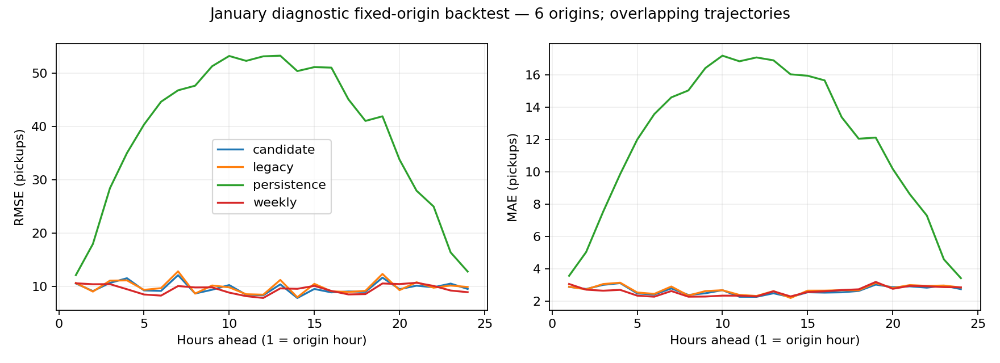

# Strict-hour demand candidate assessment — January diagnostic

Generated locally on 25 October 2026 (IST). This is retrospective diagnostic evaluation, not production approval or an untouched final test.

## Assessment

On the SAME 14,573 zone/hour rows, candidate RMSE is 8.699152 versus legacy 8.702230 (-0.035% change; negative is lower). Candidate MAE is 2.524642 versus 2.534983.
Do not attribute this difference solely to splitting: model family, tuning budget (1 versus 25 trials per estimator), training rows and selected hyperparameters also changed. No repeated-seed or independent-period superiority claim is established.

**Decision: retain the strict-split candidate for further evaluation; broad improvement or promotion is not established.** The shared-hour split issue is closed for the candidate. The paired overall change is very small, subgroup results are mixed, and a weekly baseline remains competitive or better at multiple leads. Freeze the versions and protocol before later-period evaluation.

## Exact models and validation selection

- legacy: `models:/taxi-demand-forecaster/1`, run `771eb4d4470f4da9ab8467568f9a8f34`; training params in `protocol.json`.
- candidate: `models:/taxi-demand-forecaster-strict-hourly/1`, run `2f79615caca841f2b44b7627c4de5a96`; training params in `protocol.json`.

Candidate selection: **xgboost**, chosen by validation RMSE 8.130270 over 25 trials per estimator.

| estimator | validation_rmse | diagnostic_test_rmse |
|---|---|---|
| xgboost | 8.130270 | 8.684194 |
| lightgbm | 8.314129 | 8.551785 |

LightGBM has a lower candidate-run diagnostic test RMSE, but switching after inspecting test scores would use the test for selection. Keep the predeclared validation winner.

## Native protocols — different row sets

| model | rows | rmse | mae | mape | r2 |
|---|---|---|---|---|---|
| legacy | 14573 | 8.702230 | 2.534983 | 40.191912 | 0.970743 |
| candidate | 14674 | 8.684194 | 2.520752 | 40.207213 | 0.970739 |

Native scores reproduce each model's own test protocol. Their numerical difference is not a paired model comparison.

## Paired comparison — same keys, targets and feature values

| model | rows | rmse | mae | mape | r2 |
|---|---|---|---|---|---|
| legacy | 14573 | 8.702230 | 2.534983 | 40.191912 | 0.970743 |
| candidate | 14573 | 8.699152 | 2.524642 | 40.147331 | 0.970764 |

The strict test contains 101 additional Jan 29 14:00 zone/hour rows that were in legacy validation. They are excluded from the common test comparison. Both versions are evaluated on the exact same raw feature rows; schema, targets and inputs match exactly. Prediction errors here use raw regressor output to reproduce training metrics.

`paired_predictions.csv.gz` contains all paired rows and independent error columns. `paired_subgroup_metrics.csv` compares represented borough/time/day/holiday groups on the common rows (minimum 30 rows). No one-group parity inference is permitted.

Paired borough RMSE (positive difference means candidate worsened):

| group | candidate | legacy | candidate_minus_legacy_rmse |
|---|---|---|---|
| Bronx | 0.442426 | 0.441011 | 0.001415 |
| Brooklyn | 0.739116 | 0.740575 | -0.001459 |
| EWR | 0.270262 | 0.267332 | 0.002930 |
| Manhattan | 15.781793 | 15.551222 | 0.230571 |
| Queens | 5.880090 | 6.466486 | -0.586396 |
| Staten Island | 0.079951 | 0.071174 | 0.008777 |
| Unknown | 3.277084 | 3.180872 | 0.096212 |

Queens improves while Manhattan worsens in RMSE on these identical rows. The overall result therefore does not establish consistent geographic improvement. Raw error scale and sparse subgroup support still matter.

## Fixed-origin recursive backtest

Six origins at six-hour intervals: 2024-01-29 15:00:00 through 2024-01-30 21:00:00. All 253 zones, full 24-hour trajectories; 1,518 forecasts per series at each lead. Origins start after BOTH validation cutoffs, avoiding legacy validation's extra boundary hour.

Each origin/model starts from actual hours strictly before the origin, then feeds only its own clipped, integer-rounded predictions. Scored predictions match the batch output's four-decimal rounding. Persistence holds the last available observation; weekly uses actual target-minus-168h, always before these origins. Truth joins only after trajectories are produced.

| model | horizon | rows | rmse | mae | mape |
|---|---|---|---|---|---|
| candidate | 1 | 1518 | 10.603932 | 2.878809 | 37.302835 |
| candidate | 3 | 1518 | 10.707736 | 3.005407 | 48.735848 |
| candidate | 6 | 1518 | 9.207612 | 2.404300 | 40.567580 |
| candidate | 12 | 1518 | 8.379842 | 2.264694 | 40.434341 |
| candidate | 24 | 1518 | 9.576551 | 2.740991 | 38.948790 |
| legacy | 1 | 1518 | 10.699416 | 2.890237 | 37.530985 |
| legacy | 3 | 1518 | 11.132323 | 3.057331 | 48.796907 |
| legacy | 6 | 1518 | 9.723635 | 2.447569 | 41.103580 |
| legacy | 12 | 1518 | 8.502461 | 2.319398 | 41.479183 |
| legacy | 24 | 1518 | 9.944936 | 2.844757 | 39.108367 |
| persistence | 1 | 1518 | 12.167664 | 3.565876 | 54.863150 |
| persistence | 3 | 1518 | 28.443180 | 7.536232 | 100.638403 |
| persistence | 6 | 1518 | 44.648274 | 13.572464 | 547.909874 |
| persistence | 12 | 1518 | 53.155420 | 17.081028 | 609.022912 |
| persistence | 24 | 1518 | 12.831301 | 3.419631 | 51.237086 |
| weekly | 1 | 1518 | 10.638602 | 3.059947 | 44.003795 |
| weekly | 3 | 1518 | 10.474733 | 2.644928 | 51.319865 |
| weekly | 6 | 1518 | 8.328286 | 2.273386 | 49.987411 |
| weekly | 12 | 1518 | 7.885712 | 2.285903 | 52.046189 |
| weekly | 24 | 1518 | 8.965018 | 2.851120 | 48.297043 |

At the requested leads, candidate RMSE is lower than legacy at [1, 3, 6, 12, 24]. The weekly baseline has lower RMSE than candidate at [3, 6, 12, 24]. Candidate MAE is lower than weekly MAE despite worse RMSE at leads [12, 24], so conclusions depend on the preselected loss and tolerance for large misses. Do not replace the validation-selected model or choose a new horizon/metric after observing this table.

Horizon errors need not increase monotonically here: changing the lead also changes target hours and demand levels for this small origin set. The table does not isolate error propagation from target-time composition.

All 12 model/origin checks passed: adding 10,000 to EVERY future actual count did not change any forecast. The batched feature calculation and raw outputs were cross-checked against the serving row builder at all 24 steps for the first, middle and last zone at every origin/model. See `leakage_and_serving_checks.json`.

This is a finite empirical invariance check plus explicit history truncation, not a proof covering every possible code path. Other zones use the same tested batched implementation. Actual counts before each NEW origin may include completed earlier test hours; they are not revealed inside that origin's trajectory.

These trajectories overlap and cover only three target dates. Zone/hour forecasts and overlapping origins are dependent; no significance claim or narrow confidence interval is justified. Metrics at lead h score exactly h hours ahead, not an average over leads 1..h. Raw rolling one-step, clipped recursive and baseline scores are distinct protocols.



## Coverage and remaining limits

Strict test: 58 hours across 3 dates; 0 weekend hours; 0 holiday hours. Weekend/holiday coverage gaps remain open.

Publication delays, missing/corrected source counts, true historical model availability, population shift and service equity are not established by this historical simulation. Three flagged responsible-analysis dimensions remain investigation items; error ratios alone do not establish discrimination or fairness.

## Freeze before later-period evaluation

`protocol.json` was written before this assessment's performance calculations. Models were neither retrained nor reselected. It freezes numeric identities, origins, metrics, baselines and postprocessing. Its SHA256 is in `manifest.json`.

The proposed next window is all February 2024, carried forward from January history. Calendar-only inspection using this repo's holiday function finds 8 weekend dates and holiday date(s) 2024-02-19. No February observations were downloaded, scored or used for tuning here. One holiday event cannot establish broad holiday robustness.

Before obtaining or scoring that window, freeze versions and a plan file; verify holiday definitions, timestamp conventions, minimum group support and at least 168 prior observed hours. Build continuous demand history across month boundaries; score only February targets. Report distinct days/holiday events alongside rows. If any results trigger tuning, label February development evidence and reserve a further future window with the required coverage for final evaluation. Do not call a model trained on that window externally validated by it.

## Step-by-step manual assessment

1. Open `protocol.json`. In MLflow inspect each numeric model version and its source run. Match candidate `2f79615caca841f2b44b7627c4de5a96`, validation winner, 25-trial params and the recorded split hashes. Use `Get-FileHash -Algorithm SHA256` on each recorded Parquet file. This verifies current files, not independent historical training-data provenance.
2. Open `native_metrics.csv` and `common_metrics.csv`. Confirm native counts 14,573/14,674 but common counts 14,573/14,573. Do not compare different native row sets as a paired improvement.
3. Expand `paired_predictions.csv.gz` using Python/pandas or a gzip-capable tool; retain the compressed original. Sort by zone and hour. Verify keys are unique. For both models recompute error = prediction - pickup_count, absolute error = ABS(error), squared error = error^2; MAE = AVERAGE(all absolute errors), RMSE = SQRT(AVERAGE(all squared errors)). Use ALL rows for aggregate comparison; `paired_manual_sample.csv` is only 50 worked rows. Match `common_metrics.csv` within numeric tolerance. Relative RMSE change = 100*(candidate/legacy-1).
4. Compare borough/time slices on those same rows using `paired_subgroup_metrics.csv`. Check row counts and target scale. An overall decrease does not establish improvement for every subgroup.
5. Open `first_origin_manual.csv`. Select one model and one zone, order by horizon, and confirm target_time = origin + (horizon-1) hours. Inspect raw_prediction, clipped_prediction = MAX(0,raw), history_count = int(round(clipped)), prediction = round(clipped,4). Python uses ties-to-even rounding; Excel ROUND may differ on exact .5 ties. At horizon 2 the lag_1 input must be horizon 1's history_count, not actual target-hour count. See the independent 1-zone check command in the companion instructions.
6. Review `leakage_and_serving_checks.json`: all 12 origin/model perturbations must PASS. Rerun the script to a NEW folder to reproduce the mutation test. Future targets must be changed before prediction, not after scoring. Confirm every origin exceeds both validation cutoffs and models are not fitted/tuned inside the forecast period.
7. Filter `backtest_predictions.csv.gz` by exact horizon and model. Compute MAE/RMSE using all 1,518 rows at that lead; compare with persistence and weekly on the SAME origin/zone/target keys. Keep origin/day counts visible. Match `horizon_metrics.csv`; do not average already-computed subgroup RMSEs to obtain overall RMSE.
8. Open `coverage.json`. Verify zero weekend/holiday test hours and three scored dates. Inspect the proposed February calendar; it is a plan, not actual data coverage. Freeze models/protocol before fetching later data and check observed support after ingestion.
9. Write a scoped conclusion with numeric model URIs, common-row count, exact horizon/protocol and coverage limits. State measured RMSE/MAE changes rather than a general improvement or deployment claim. Stop tuning against January.

## Reproduce

```powershell
.\.venv\Scripts\python.exe -m scripts.assess_strict_demand --old-version 1 --candidate-version 1 --output artifacts/strict-demand/assessment-your-repeat
```

Use a fresh output directory. This reads local data and numeric registered models; it does not train, register or deploy. The companion `MANUAL_ASSESSMENT.md` contains independent commands for recomputing scores and checking one recursive trajectory.
